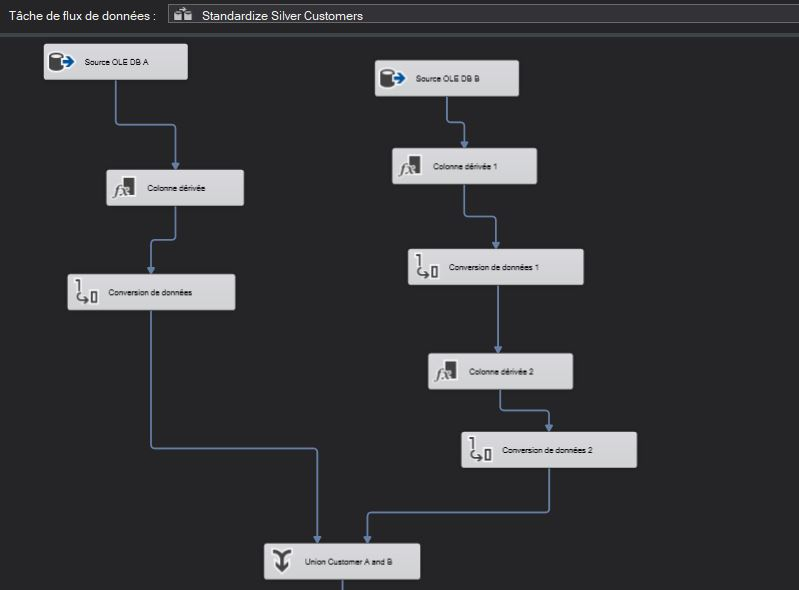
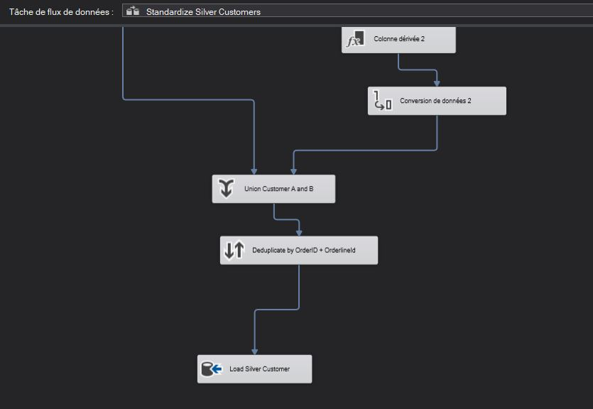
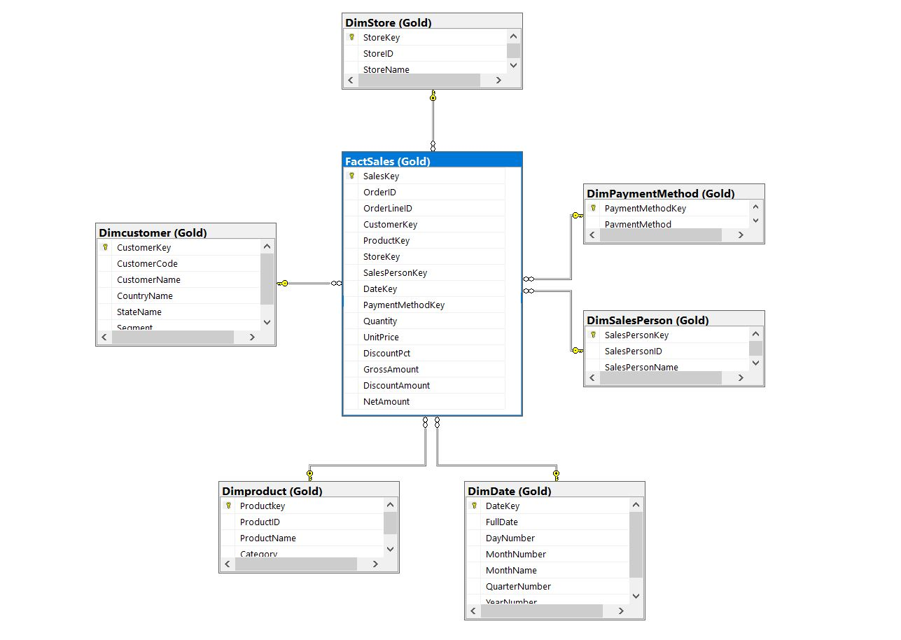
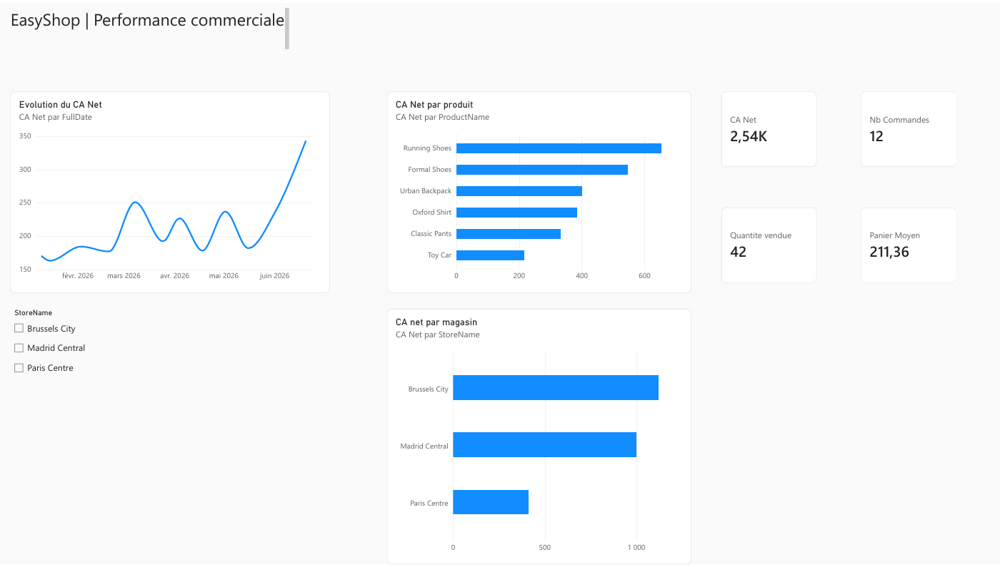
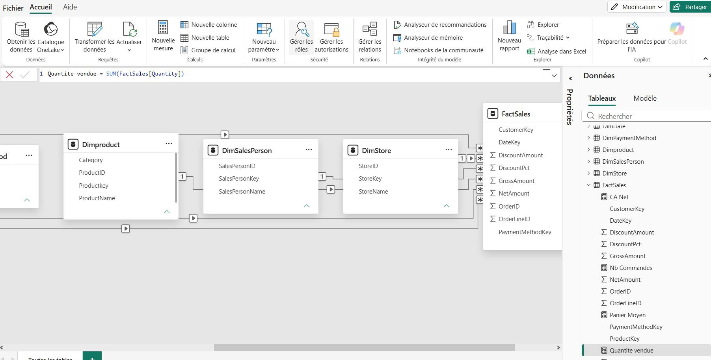

# EasyShop Data Warehouse

## Project overview

EasyShop Data Warehouse is an end-to-end Business Intelligence project that demonstrates the design and implementation of an ETL pipeline using SQL Server Integration Services (SSIS).

Customer data from multiple Excel sources is extracted, cleaned, standardized, deduplicated and loaded into SQL Server using a Bronze–Silver–Gold architecture.

The project illustrates how heterogeneous operational data can be transformed into reliable, structured data ready for reporting and analysis.

## Architecture

### Bronze layer

The Bronze layer stores raw customer data imported from the Excel source files with minimal transformation.

### Silver layer

The Silver layer improves data quality through:

* Text trimming and standardization
* Data-type conversion
* Column alignment between different sources
* Data validation
* Dataset consolidation using `Union All`
* Duplicate identification and removal

### Gold layer

The Gold layer prepares clean and structured data for analytical use, reporting and a Power BI sales dashboard.

## ETL workflow

The SSIS package performs the following steps:

1. Extract customer data from multiple Excel files.
2. Load the raw data into Bronze tables.
3. Clean and standardize the source datasets.
4. Convert columns into consistent data types.
5. Align the schemas of the different sources.
6. Merge the datasets using `Union All`.
7. identify and remove duplicate records.
8. Load the transformed data into SQL Server.
9. Prepare structured Gold-layer data for analysis.

## Project visuals

### Silver-layer transformation

The two Bronze datasets are standardized through derived columns and data-type conversions before being consolidated using `Union All`.

After consolidation, duplicate records are removed using the combination of `OrderID` and `OrderLineID`, and the clean dataset is loaded into `Silver.Customer`.

### Gold-layer star schema

The Gold layer uses a star schema with `FactSales` at its centre, connected to customer, product, store, salesperson, date and payment-method dimensions.

## Power BI sales dashboard

The project now extends the Gold layer into a Power BI sales report, built in Power BI Service with Power Query, a semantic model and DAX measures.

**[View or download the sales report (PDF)](docs/power-bi/EasyShop-Sales-Report.pdf)**

The report includes net sales, distinct order count, units sold and average order value, a sales timeline, product and store rankings, and an interactive store slicer. Store filtering was checked to confirm that the cards and charts recalculate together.

### Semantic model

`FactSales` is linked to six dimensions: `DimCustomer`, `DimDate`, `DimPaymentMethod`, `Dimproduct`, `DimSalesPerson` and `DimStore`. All six relationships are active, many-to-one from the fact table to each dimension, with single-direction filtering from dimensions to facts.

### Measures

The four measure definitions are documented in [power-bi/measures.dax](power-bi/measures.dax). `DISTINCTCOUNT(OrderID)` counts orders rather than sales lines; `DIVIDE` calculates average order value safely.

### Current delivery and limitations

* The current demonstration contains 28 sales lines, 12 distinct orders and 42 units; the displayed average order value is 211.36. Net sales are shown rounded as 2.54K.
* Gold tables were exported from SQL Server and manually imported as CSV files because no data gateway was configured. This version does not provide automatic refresh.
* The fact-table export uses a semicolon delimiter to avoid conflicts with decimal commas. Windows-1252 encoding is used for the original exports containing accented text; import settings must match each file.
* `DimDate` currently contains transaction dates rather than a continuous daily calendar. Lines between observed dates do not establish sales activity or growth on unobserved dates.
* The PDF and preview are static. The interactive report is hosted in Power BI; no public or externally verified interactive link is provided here.
* This update documents the report and its measures. A `.pbix` file, CSV extracts and deployable Power BI semantic-model source are not included, so the report cannot be recreated from this repository alone.
* Results describe this small demonstration dataset and should not be treated as evidence of real store performance. Currency is not asserted because it has not been verified.

## Technologies

* Microsoft SQL Server
* SQL Server Integration Services (SSIS)
* SQL
* Microsoft Power BI Service and Power Query
* DAX
* Microsoft Excel
* Visual Studio
* Git and GitHub

## Repository contents

* `01_create_easyshop_dw.sql` — SQL script used to create the EasyShop Data Warehouse structure
* `EasyShop_ETL.dtsx` — SSIS package containing the complete ETL workflow
* `EasyShop_ETL.dtproj` — Visual Studio Integration Services project file
* `EasyShop_ETL.sln` — Visual Studio solution
* `Project.params` — SSIS project parameters
* `.gitignore` — Git exclusion rules for generated and user-specific files

## How to run the project

### Requirements

* Microsoft SQL Server
* SQL Server Management Studio
* Visual Studio with the SQL Server Integration Services extension
* Access to the required Excel source files

### Execution

1. Run `01_create_easyshop_dw.sql` in SQL Server Management Studio.
2. Open `EasyShop_ETL.sln` in Visual Studio.
3. Configure the Excel and SQL Server connection managers for the local environment.
4. Verify the source-file paths and project parameters.
5. Execute `EasyShop_ETL.dtsx`.
6. Validate the loaded data in the Bronze, Silver and Gold layers.

> The original Excel source files and local connection settings are not included in this repository. They must be configured locally before execution.

## Skills demonstrated

* ETL pipeline development
* Data warehouse architecture
* Data cleaning and standardization
* Data-type conversion
* Multi-source data integration
* Duplicate management
* SQL database development
* SSIS workflow design
* Git version control
* Technical documentation

## Future improvements

* Add data-quality checks and error logging
* Add automated package execution
* Extend the Power BI dashboard with category and customer analysis
* Add a continuous calendar before implementing time-intelligence measures
* Replace manual CSV imports with a scheduled SQL Server connection through a gateway

## Author

**Julien Mbolekome**
Business Intelligence professional based in Brussels
